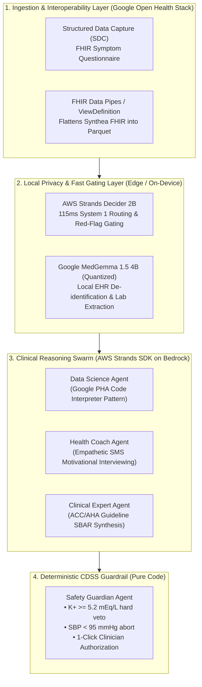

# Deep Research: Google's Open-Source Healthcare Stack & Health AI Developer Foundations

**Technical Analysis & Integration Architecture for Multimodal Multi-Agent Systems**  
**Subject:** Google Open Health Stack (OHS), Health AI Developer Foundations (HAI-DEF), MedGemma, and Personal Health Agent (PHA)  
**Primary Sources:**  
- Google Open Health Stack Documentation & Repositories (`developers.google.com/open-health-stack`, `google/android-fhir`, `google-health/fhir-data-pipes`)  
- Google DeepMind & Google for Developers: Health AI Developer Foundations (`developers.google.com/health-ai-developer-foundations`, `google-health/medgemma`, `deepmind.google/models/gemma/medgemma`)  
- Google Health Research: *Nature Medicine* Personal Health Agent (`Google-Health/consumer-health-research`, `google-research/harness2`)  
**Date:** October 2026  
**Document Location:** `docs/research/google_open_health_stack_and_medgemma_research.md`  

---

## 1. Executive Summary: The Open Google Health Ecosystem

Google has established two distinct yet synergistic open-source healthcare pillars that provide foundation-level infrastructure for digital health developers:

```mermaid
flowchart TD
    subgraph DataInfrastructure ["Pillar 1: Google Open Health Stack (OHS)"]
        direction TB
        SDC["Structured Data Capture (SDC)<br/>• FHIR Questionnaires<br/>• FHIRPath validation"]
        FE["Android FHIR Engine<br/>• Encrypted offline store<br/>• Bi-directional sync"]
        WL["Workflow & CQL Engine<br/>• On-device guideline logic<br/>• WHO SMART Guidelines"]
        DP["FHIR Data Pipes (Analytics)<br/>• SQL-on-FHIR v2<br/>• Parquet-on-FHIR via Apache Beam"]
        GW["FHIR Info Gateway<br/>• SMART-on-FHIR proxy<br/>• RBAC / Patient access control"]
    end

    subgraph OpenAIModels ["Pillar 2: Health AI Developer Foundations (HAI-DEF)"]
        direction TB
        MG4["MedGemma 1.5 (4B Multimodal)<br/>• Gemma 3 + MedSigLIP encoder<br/>• 128k context, GQA<br/>• High-dim CT/MRI & EHR extraction"]
        MG27["MedGemma (27B Text/Multimodal)<br/>• Deep clinical reasoning<br/>• Patient interviewing & CDS"]
        MSIG["MedSigLIP (0.9B Vision-Language)<br/>• Medical zero-shot classification<br/>• Radiology, dermatology, pathology"]
        HEAR["HeAR (Lung Acoustics)<br/>• Masked Autoencoder<br/>• Non-speech cough/breathing bioacoustics"]
        ASR["MedASR (Medical Speech)<br/>• Conformer-based clinical dictation"]
        TX["TxGemma (Therapeutics)<br/>• Small molecules & proteins"]
    end

    subgraph AgenticIntegration ["AegisHealth AI Integration (AWS Strands Swarm)"]
        Aegis["AegisHealth Cardiorenal Guardian"]
    end

    DataInfrastructure --> Aegis
    OpenAIModels --> Aegis
```

Together, these pillars provide:
1. **The Standards & Interoperability Layer (OHS):** Production-ready HL7 FHIR R4 pipelines, offline mobile capture, and SQL-on-FHIR analytics engines recognized as **Digital Public Goods (DPGA)** and **Global Goods for Health (WHO / Digital Square)**.
2. **The Specialized Medical AI Layer (HAI-DEF):** Open-weight clinical models (MedGemma, MedSigLIP, HeAR) specifically designed to run either locally (edge/on-premise) or as modular tools within larger multi-agent architectures.

---

## 2. Pillar 1: Google Open Health Stack (OHS) Deep Dive

### 2.1 Android FHIR SDK (`google/android-fhir`)
The Android FHIR SDK is a suite of Kotlin libraries built in collaboration with the World Health Organization (WHO) to enable offline-first, mobile-native FHIR healthcare applications.

It is structured into four modular libraries:
1. **Structured Data Capture (SDC) Library:**
   - Automatically renders standard HL7 FHIR `Questionnaire` resources into rich native UI forms.
   - Evaluates complex conditional logic and field dependencies dynamically using embedded **FHIRPath expressions** (e.g. showing orthopnea questions only if the patient reports shortness of breath).
   - Validates data client-side before conversion into FHIR `QuestionnaireResponse` and target domain resources (`Observation`, `Condition`).
2. **FHIR Engine Library:**
   - Provides local, encrypted storage (SQLCipher / Room) for FHIR resources directly on the client device.
   - Includes a fluent Kotlin DSL for querying and filtering local clinical records.
   - Implements robust bi-directional sync protocols to reconcile local modifications with remote FHIR servers (e.g. HAPI FHIR, Google Cloud Healthcare API, AWS HealthLake) with conflict resolution.
3. **Workflow Library:**
   - Powers on-device clinical decision support (CDS) by executing **HL7 Clinical Quality Language (CQL)** directly against local FHIR data.
   - Enables developers to run official WHO SMART Guidelines and clinical clinical rules offline without server round-trips.
4. **Knowledge Manager Library:**
   - Manages and packages FHIR Implementation Guide (IG) knowledge artifacts, terminology value sets, and CQL logic libraries.

### 2.2 FHIR Info Gateway
- A standalone reverse proxy that sits between mobile/web clients and backend FHIR repositories.
- Enforces organizational access control, OAuth 2.0 / SMART on FHIR scopes, and patient-level data segregation (ensuring community health workers or clinicians only receive records for their assigned patient panels).

### 2.3 FHIR Data Pipes & Analytics (`google-health/fhir-data-pipes`)
- **The Core Problem:** FHIR JSON resources are deeply nested, hierarchical, and polymorphic (arrays of codings, extensions, references), making analytical queries and cohort analytics in standard SQL notoriously complex and slow.
- **The Solution:** Google's FHIR Data Pipes uses **Apache Beam** ETL pipelines to ingest raw FHIR bundles and stream them into a columnar **Parquet-on-FHIR** schema.
- **SQL-on-FHIR v2 Specification:** Implements ANSI SQL ViewDefinitions, allowing developers to flatten nested FHIR arrays into clean, relational tabular formats.
- **Query Interoperability:** The resulting Parquet files can be directly queried with zero overhead using DuckDB, PySpark, Google BigQuery, or AWS Athena.

---

## 3. Pillar 2: Google Health AI Developer Foundations (HAI-DEF)

Google's Health AI Developer Foundations represents a shift toward **open-weight, task-specialized clinical foundation models** that developers can download from Hugging Face or deploy on Google Cloud / AWS infrastructure.

### 3.1 MedGemma: Architecture & Clinical Capabilities
Built on the **Gemma 3** architecture, MedGemma models are specifically fine-tuned for medical text comprehension, clinical reasoning, and multimodal biomedical image interpretation.

| Model Variant | Base Architecture | Modality | Context Window | Primary Clinical Use Cases |
| :--- | :--- | :--- | :--- | :--- |
| **MedGemma 1.5 4B (`google/medgemma-1.5-4b-it`)** | Gemma 3 + MedSigLIP image encoder | Multimodal (Text + Vision) | **128,000 tokens** (Grouped-Query Attention) | High-dimensional imaging (CT, MRI, whole-slide pathology), longitudinal chest X-rays, anatomical localization, structured lab report & EHR text extraction. |
| **MedGemma 4B (`google/medgemma-4b-it`)** | Gemma 3 + SigLIP | Multimodal | 128k tokens | 2D medical imaging QA, dermatology, radiology reporting. |
| **MedGemma 27B Text (`google/medgemma-27b-text-it`)** | Gemma 3 (Decoder-only Transformer) | Text-only | 128k tokens | Advanced clinical reasoning, complex differential diagnosis, guideline synthesis, patient interview interpretation. |
| **MedGemma 27B Multimodal (`google/medgemma-27b-it`)** | Gemma 3 + MedSigLIP | Multimodal | 128k tokens | Multi-image diagnostic synthesis, cross-specialty clinical analysis. |

#### Key Technical Highlights of MedGemma 1.5 4B:
- **Longitudinal Image Comparison:** Specifically trained to analyze temporal changes between sequential images (e.g. comparing today's chest X-ray against one from 6 months ago to detect subtle pleural effusions or cardiomegaly progression).
- **Structured Data Extraction from Messy EHRs:** Fine-tuned to parse unstructured physician notes, discharge summaries, and PDF lab results into structured key-value clinical variables with span-level provenance.
- **Edge Deployable:** At 4 billion parameters, it can be quantized (INT4/INT8 via GGUF/AWQ) and run on Apple Silicon (MPS), consumer GPUs, or local edge servers, providing complete **zero-data-egress privacy (HIPAA compliant)**.

### 3.2 Companion Foundation Models in HAI-DEF
1. **MedSigLIP (0.9B Vision-Language):**
   - Fine-tuned SigLIP model covering 6 modalities: chest X-rays, CT slices, MRI slices, dermatology, ophthalmology, and digital pathology.
   - Excels at zero-shot classification and semantic medical image search (e.g. finding similar historic lesions).
2. **HeAR (Health Acoustic Representations):**
   - A Masked Autoencoder bioacoustic foundation model trained on massive non-speech human acoustic datasets.
   - Extracts deep representations from **coughs, breaths, throat clearings, and vocal sounds**.
   - Clinically validated for detecting early pulmonary changes (COPD exacerbations, tuberculosis, asthma, and fluid-induced pulmonary congestion).
3. **MedASR:**
   - Conformer-based speech-to-text model specialized in medical vocabulary, multi-speaker clinical accents, pharmaceutical names, and complex medical dictation.
4. **TxGemma:**
   - Molecular and protein foundation model based on Gemma 2 for small-molecule property prediction, target disease mapping, and therapeutic generation.

---

## 4. Google Health Research: Personal Health Agent (PHA) & Harness 2

### 4.1 Nature Medicine Personal Health Agent (PHA)
In 2024–2025, Google Research published landmark findings in *Nature Medicine* describing the **Anatomy of a Personal Health Agent**:
- **The Core Architecture:**
  - `DataScienceAgent`: Runs a secure Python code interpreter sandbox to clean and calculate rolling biometrics (EWMA, step variance, HRV RMSSD trends) over weeks of passive wearable data.
  - `ClinicalExpertAgent`: Translates numerical trends into physiological interpretations based on medical literature.
  - `CommunicationAgent`: Interacts with the patient using motivational interviewing principles to contextualize data (e.g. asking if a sleep disturbance was caused by alcohol, late dining, or subclinical orthopnea).
- **Key Empirical Finding:** Generative LLMs fail at physiological timeseries analysis when asked to interpret raw numbers directly; they achieve superior accuracy and clinical safety when given **code execution tools to compute statistical rolling features** before reasoning.

### 4.2 Harness 2 (`google-research/harness2`)
- Google Research's modular benchmarking harness designed to evaluate multi-step reasoning agents against complex, domain-specific evaluation rubrics.
- Allows rigorous offline evaluation of agent trajectories, tool parameter validity, and trajectory drift.

---

## 5. Architectural Synthesis: Bridging Google's Open Stack with AWS Strands for AegisHealth AI

By combining **Google's Open Health Stack** and **HAI-DEF open-weights** with the **AWS Strands SDK**, we construct an elite, cross-ecosystem architecture for the hackathon and YC venture pitch:

### Strategic Innovations for Our Submission:
1. **Google PHA Code Interpreter Pattern in Strands:**
   - Our `DataScienceAgent` adopts the exact Google PHA architecture: using Python tool execution (`pandas`, `scipy`) to compute 3-day and 7-day rolling weight velocities and HRV compression rather than asking the LLM to calculate math in prompt text.
2. **Google HeAR Concept for Subclinical Congestion:**
   - We cite Google's **HeAR** bioacoustic research as scientific evidence that subclinical pulmonary congestion manifests in vocal and respiratory changes days before overt dyspnea, justifying our proactive SMS conversational check-in model.
3. **Google SQL-on-FHIR for Fast Cohort Loading:**
   - We leverage the SQL-on-FHIR flattening pattern to transform complex Synthea FHIR bundles into fast tabular DataFrames for our demo dashboard.
4. **Local MedGemma + Strands Decider Hybrid:**
   - We can highlight how **MedGemma 1.5 4B** handles on-premise medical document understanding, while **Strands Decider 2B** handles 115ms agent tool gating—keeping sensitive patient records inside a zero-cloud-egress boundary.
