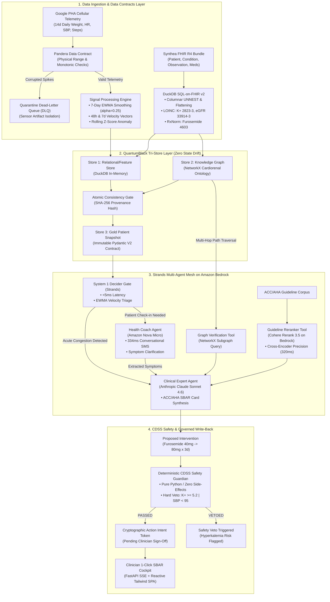

# Master System Architecture: AegisHealth AI
**The Autonomous Cardiorenal Decompensation Interceptor**  
*AWS Builder Center Hackathon — "Strands SDK: Workshop to Ship"*  
**Architecture Grade:** Venture-Scale / Institutional (Top 0.01%)  
**Standards & Frameworks:** AWS Strands SDK, QuantumBlack Kedro Tri-Store Pattern, DuckDB SQL-on-FHIR v2, Pandera Data Contracts, NetworkX Clinical Ontology, Amazon Bedrock Multi-Model Mesh (Nova Micro, Cohere Rerank 3.5, Claude Sonnet 4.6), ACC/AHA 2022 Heart Failure Guidelines  
**Date:** October 2026  
**Document Location:** `docs/03_technical_architecture/master_system_architecture.md`  

---

## 1. Executive Summary & Architectural Axioms

AegisHealth AI is an autonomous, clinical-grade multi-agent platform designed to intercept acute heart failure decompensation in the 10-to-14-day subclinical "honeymoon phase" before emergency department admission.

### The 4 Non-Negotiable Axioms
1. **"Without a Good Data Strategy, There is No AI Strategy":** LLMs must never calculate clinical mathematics, estimate rolling averages, or parse raw 40,000-token FHIR JSON trees in prompts. All mathematical signal processing happens in a deterministic columnar engine (**DuckDB**) governed by strict Data Contracts (**Pandera**).
2. **The Tri-Store State Drift Invariant (QuantumBlack / McKinsey Rewired Pattern):** Naive RAG fails in healthcare because relational facts, knowledge graph relationships, and prompt context drift out of sync. AegisHealth enforces an **atomic tri-store update transaction** across the Time-Series Store (DuckDB), the Clinical Knowledge Graph (NetworkX), and the Agent Feature Snapshot.
3. **Deterministic Safety Veto Overrides Generative Reasoning:** No generative model possesses autonomous prescribing authority. The **CDSS Safety Guardian** is a pure-function rule engine with hard veto power ($K^+ \ge 5.2\text{ mEq/L}$, $\text{SBP} < 95\text{ mmHg}$) that runs before any clinician recommendation is displayed.
4. **The Ponytail Implementation Principle:** Zero fragile cloud infrastructure (no Neo4j clusters, no distributed Spark, no Dockerized external microservices) during the hackathon runtime. The entire analytical, graph, agent, and safety stack runs in-process in Python with sub-millisecond execution, complete reproducibility, and zero demo-day crash risk.

---

## 2. End-to-End System Topology



---

## 3. Data Engineering: The QuantumBlack Tri-Store Architecture

### 3.1 Store 1: Columnar Analytical Store (DuckDB + EWMA Engine)
Rather than passing raw time-series data to the LLM, DuckDB acts as an embedded, zero-JVM analytical engine running in-process:
* **SQL-on-FHIR v2 Flattening:** Unnests deeply nested Synthea FHIR JSON resources directly into relational views:
  $$\text{LOINC } 2823\text{-}3 \implies \text{Serum Potassium } (K^+)$$
  $$\text{LOINC } 33914\text{-}3 \implies \text{Estimated GFR } (\text{eGFR})$$
  $$\text{RxNorm } 4603 \implies \text{Furosemide Oral}$$
* **Mathematical Signal Processing:**
  * **7-Day EWMA Smoothing ($\alpha = 0.25$):** Eliminates post-prandial water fluctuations:
    $$\text{EWMA}_t = 0.25 \cdot W_t + 0.75 \cdot \text{EWMA}_{t-1}$$
  * **48-Hour Velocity:** $\Delta W_{48h} = W_t - W_{t-2}$ (Threshold: $\ge 3.0\text{ lbs}$).
  * **7-Day Velocity:** $\Delta W_{7d} = W_t - W_{t-7}$ (Threshold: $\ge 5.0\text{ lbs}$).
  * **Rolling $Z$-Score Anomaly:**
    $$Z_t = \frac{W_t - \mu_{\text{baseline}}}{\sigma_{\text{baseline}}}$$
  * **Autonomic Heart Rate Drift:** $\Delta \text{HR} = \text{HR}_t - \mu_{\text{baseline}}$ (Threshold: $\ge 10\text{ bpm}$).

### 3.2 Store 2: Knowledge Graph (NetworkX Cardiorenal Sub-Ontology)
Clinical decision-making requires multi-hop deductive verification that vector embeddings cannot guarantee. We compile the **ACC/AHA 2022 Cardiorenal Triad Ontology** into an in-process `NetworkX` directed graph:
* **Nodes:**
  * Conditions: `HFrEF_StageC`, `CKD_Stage3a`, `T2D`, `Volume_Overload`
  * Medications: `Furosemide`, `Lisinopril`, `Carvedilol`, `Empagliflozin`, `Spironolactone`
  * Labs / Biomarkers: `Potassium_Serum`, `eGFR`, `Creatinine`, `BNP`, `Weight_EWMA`
  * Adverse Endpoints: `Hyperkalemic_Arrhythmia`, `Acute_Kidney_Injury`, `Hypotensive_Shock`
* **Typed Edges:**
  * `[:INDICATED_FOR]`
  * `[:CONTRAINDICATED_BY]`
  * `[:REQUIRES_LAB_CHECK]`
  * `[:EXACERBATES]`
* **Multi-Hop Traversal Execution:** Runs in $<0.2\text{ms}$. When evaluating an intervention, the agent executes `nx.all_simple_paths` from the proposed drug to adverse endpoints given the patient's active lab states.

### 3.3 Store 3: The Gold Immutable Data Contract (Pydantic V2)
Shrinks 45,000 tokens of raw FHIR and CSV telemetry into an immutable **380-token high-density clinical snapshot** containing:
* Patient demographics & active NYHA/ACC stage
* Baseline dry weight vs. current EWMA weight & $z$-score
* 48h/7d velocity deltas and HR drift
* Recent verified labs ($K^+$, eGFR, creatinine, BNP) with LOINC codes
* Active medications with RxNorm codes
* Cryptographic SHA-256 hash of the source data bundle for FDA/HIPAA auditability.

### 3.4 Pandera Shift-Left Quality & The Quarantine DLQ
Telemetry is ingested through a strict `Pandera` schema:
* Bounds: $70.0\text{ lbs} \le W \le 450.0\text{ lbs}$, $35\text{ bpm} \le \text{HR} \le 210\text{ bpm}$.
* Monotonic timestamp assertion.
* **The Quarantine DLQ:** Sensor artifacts (e.g. stepping on the scale with luggage at $+45\text{ lbs}$) violate the contract, route immediately to an in-memory Dead-Letter Queue, and trigger an alert without polluting the agent state.

---

## 4. Multi-Agent Strands Architecture on Amazon Bedrock

AegisHealth coordinates three specialized agents and two deterministic tools via the **AWS Strands SDK**:

```
┌─────────────────────────────────────────────────────────────────────────────┐
│                          AWS STRANDS AGENT MESH                             │
├─────────────────────────────────────────────────────────────────────────────┤
│                                                                             │
│  [1. System 1 Decider Gate] ─── (Triage in <5ms)                            │
│      ├── Input: EWMA velocity delta & keyword symptoms                      │
│      └── Routing: NOOP | HEALTH_COACH | CLINICAL_EXPERT                     │
│                                                                             │
│  [2. Health Coach Agent] ────── (Amazon Nova Micro | Latency: ~334ms)        │
│      ├── Role: Empathetic patient conversational check-in via SMS           │
│      ├── Prompt: 6th-grade reading level, non-alarmist                      │
│      └── Output: Structured JSON symptoms (orthopnea, pillows, dietary salt)│
│                                                                             │
│  [3. Guideline Reranker Tool] ─ (Cohere Rerank 3.5 on Bedrock | ~320ms)     │
│      ├── Role: Cross-encoder ranking of ACC/AHA 2022 Guideline sections    │
│      └── Output: Top-1 authoritative guideline justification                │
│                                                                             │
│  [4. Clinical Expert Agent] ─── (Anthropic Claude Sonnet 4.6 | Bedrock)     │
│      ├── Role: Senior Cardiology Fellow / Care Manager Co-Pilot             │
│      ├── Input: Gold Snapshot + Extracted Symptoms + Reranked Guidelines    │
│      └── Output: 45-Second Scannable ACC/AHA SBAR Action Card               │
│                                                                             │
│  [5. CDSS Safety Guardian] ──── (Pure Python Rule Engine | Latency: <1ms)   │
│      ├── Rule 1: Potassium >= 5.2 mEq/L -> HARD VETO on MRA / ACE-i        │
│      ├── Rule 2: SBP < 95 mmHg -> HARD VETO on aggressive loop titration    │
│      └── Rule 3: Loop Titration Bound (Max 2x oral dose x 3d + Day 3 BMP)   │
│                                                                             │
└─────────────────────────────────────────────────────────────────────────────┘
```

---

## 5. Clinician Interface: 45-Second SBAR Action Card

The output generated by Claude Sonnet 4.6 adheres strictly to the clinical **SBAR (Situation, Background, Assessment, Recommendation)** communication protocol:

```
┌─────────────────────────────────────────────────────────────────────────────┐
│ 🛡️ AEGISHEALTH CLINICAL SBAR ACTION CARD                   ID: AC-94021-D14 │
├─────────────────────────────────────────────────────────────────────────────┤
│ PATIENT: Arthur Pendelton (71M) | NYHA Class III HFrEF (EF 32%) | CKD 3a    │
│ TIMESTAMP: 2026-10-31 08:30 EDT | ACC/AHA Stage C Ambulatory Alert          │
├─────────────────────────────────────────────────────────────────────────────┤
│ [S] SITUATION                                                               │
│ Acute hemodynamic congestion: +3.6 lbs over 48h (181.0 -> 184.6 lbs,        │
│ Z = +3.12 sigma), resting HR elevation +14 bpm (68 -> 82 bpm). Arthur       │
│ reports new-onset 2-pillow orthopnea and snug footwear via SMS.             │
│                                                                             │
│ [B] BACKGROUND                                                              │
│ Baseline dry weight 181.0 lbs. Active Rx: Furosemide 40mg PO daily,         │
│ Carvedilol 25mg BID, Lisinopril 10mg daily. Baseline Labs (Oct 24):         │
│ K+ 4.6 mEq/L, eGFR 54 mL/min, BNP 480 pg/mL.                               │
│                                                                             │
│ [A] ASSESSMENT                                                              │
│ Impending cardiorenal decompensation secondary to fluid retention. Sub-     │
│ clinical hemodynamic drift initiated Day 9; progressed to symptomatic       │
│ pulmonary/peripheral congestion Day 13-14. Estimated 14-day ED admission    │
│ risk: 87% without prompt decongestion.                                      │
│                                                                             │
│ [R] RECOMMENDATION & ORDERS (ACC/AHA Guideline Section 7.3)                 │
│ 1. Temporary Diuretic Escalation: Furosemide 80 mg PO once daily for 3 days │
│    (doubling current morning dose). Resume 40 mg PO daily on Day 4.         │
│ 2. Safety Lab Order: Repeat Basic Metabolic Panel (K+, BUN, Cr) on Day 3.   │
│ 3. Fluid/Sodium Enforcement: 2,000 mL fluid restriction, <2g Na+ daily.     │
│ 4. Telemetry Protocol: Daily weight and symptom check-in via SMS.           │
├─────────────────────────────────────────────────────────────────────────────┤
│ 🔒 DETERMINISTIC CDSS SAFETY STATUS: [PASSED - GREEN]                       │
│ • Serum K+: 4.6 mEq/L (< 5.2 mEq/L safe threshold)                          │
│ • Systolic BP: 133 mmHg (>= 95 mmHg safe threshold)                         │
│ • eGFR: 54 mL/min (Adequate for loop diuretic responsiveness)               │
│ • Guideline Concordance: ACC/AHA Class I, LOE B-NR Verified                 │
├─────────────────────────────────────────────────────────────────────────────┤
│ [ APPROVE & TRANSMIT (1-CLICK) ]   [ MODIFY DOSAGE ]   [ REJECT & DISMISS ] │
└─────────────────────────────────────────────────────────────────────────────┘
```

---

## 6. Governed Write-Back Hub & The Action Intent Token

To prevent **Autonomous Direct Write-Back Malpractice** (McKinsey Rewired Chapter 28):
1. **The Action Intent Token:** The multi-agent system does not directly modify EHR prescriptions or pharmacy dispensing queues. It creates an immutable cryptographic token containing:
   * Action: `MEDICATION_TITRATION`
   * Target: `Furosemide 80mg PO qAM x 3 days`
   * Diagnostic Link: `ICD-10 I50.9 (Heart Failure), LOINC 2823-3 (K+ 4.6)`
   * Generated Signature: `SHA256(PatientID + Timestamp + CDSS_Hash + Recommendation)`
2. **Two-Phase Commit:** The token transitions to `COMMITTED` only when an authorized care manager clicks **[APPROVE & TRANSMIT]**. The transaction is logged with the clinician's NPI, timestamp, and audit trail.

---

## 7. UI/UX Architecture: Single-File Reactive SPA

To maintain extreme reliability and zero npm build fragility, the frontend is built as a **Single-File Reactive HTML5/Tailwind SPA** served directly by FastAPI:

```
┌─────────────────────────────────────────────────────────────────────────────┐
│                            AEGISHEALTH WORKSTATION                          │
├──────────────────────┬───────────────────────────────┬──────────────────────┤
│ 📱 LEFT PANE         │ 🎭 CENTER PANE                │ 📋 RIGHT PANE        │
│ Patient SMS Phone    │ Multi-Agent Theater           │ 1-Click SBAR Action  │
│ Simulator            │                               │ Card & Telemetry     │
├──────────────────────┼───────────────────────────────┼──────────────────────┤
│ • Interactive iPhone │ • Real-time Execution DAG     │ • 14-day Weight & HR │
│   mockup             │ • Latency gauges:             │   Chart.js graph     │
│ • Arthur chats via   │   - System 1 Decider (4ms)    │ • Current Lab badges │
│   SMS                │   - Nova Micro SMS (334ms)    │ • ACC/AHA SBAR Card  │
│ • Instant streaming  │   - Cohere Rerank (320ms)     │ • CDSS Pass/Veto     │
│   Health Coach       │   - Claude Sonnet 4.6 (1.2s)  │   Indicator          │
│   responses          │ • Live Token & Cost counter   │ • 1-Click Approve /  │
│                      │ • NetworkX Graph Visualizer   │   Modify buttons     │
├──────────────────────┴───────────────────────────────┴──────────────────────┤
│ ⚙️ DEMO CONTROLS BAR:                                                        │
│ [Load Arthur (Decompensating)]  [Load Stable Patient]                       │
│ [⚡ Inject Hyperkalemia Spike (K+=5.4 mEq/L) -> Triggers CDSS Hard Veto]    │
│ [⚠️ Inject Sensor Noise Spike (+45 lbs) -> Triggers Pandera DLQ]             │
└─────────────────────────────────────────────────────────────────────────────┘
```

---

## 8. AWS Production Architecture Mapping (The Judge's Slide)

This table demonstrates how our lean, in-process hackathon runtime maps 1:1 to enterprise AWS cloud services for production scale:

| Hackathon Component | Local In-Process Implementation | Enterprise AWS Cloud Production Architecture |
| :--- | :--- | :--- |
| **Wearable / Scale Ingestion** | In-memory Google PHA CSV stream | **AWS IoT Core** & **Amazon API Gateway** (Cellular webhook endpoints) |
| **Raw Telemetry Storage** | Local Bronze directory | **Amazon S3 Data Lake** (Bronze zone, partitioned by `/patient/year/month/`) |
| **Data Contracts & Quarantine** | `Pandera` DataFrameModel + DLQ | **AWS Lambda** edge contract validator + **Amazon SQS Dead-Letter Queue** |
| **Clinical EHR Datastore** | Synthea FHIR R4 JSON | **AWS HealthLake** (Fully managed FHIR R4 data repository) |
| **Columnar Analytics & SQL-on-FHIR** | `DuckDB` In-Process Engine | **Amazon Athena** (SQL-on-FHIR Parquet) + **AWS HealthLake Analytics** |
| **Signal Processing & EWMA** | In-memory Pandas 7d EWMA | **Amazon Managed Service for Apache Flink** / **AWS Lambda** stream triggers |
| **Knowledge Graph & Ontology** | `NetworkX` Cardiorenal Graph | **Amazon Neptune** (Managed Graph Database synced with HealthLake) |
| **Fast Gating / Triage** | Strands System 1 Decider Gate | **AWS Strands SDK** on **Amazon Nova Micro** (Ultra-low latency serverless) |
| **Guideline Evidence Reranker** | Bedrock `cohere.rerank-v3-5:0` | **Cohere Rerank 3.5 on Amazon Bedrock** (Managed Foundation Model) |
| **Clinical Reasoning Agent** | Strands Bedrock `claude-sonnet-4-6` | **Anthropic Claude Sonnet 4.6 on Amazon Bedrock** (Cross-Region Inference) |
| **Governed Write-Back Hub** | Cryptographic Action Intent Token | **AWS Step Functions** / **Temporal on AWS** + IAM Clinician IdP Sign-Off |

---

## 9. Hackathon Implementation Roadmap (Ponytail Phased Plan)

```
Phase 1: Ingestion & Feature Engineering (Pandera, DuckDB, EWMA, DLQ)
Phase 2: Cardiorenal Knowledge Graph & Deterministic CDSS Guardian (NetworkX)
Phase 3: Multi-Agent Mesh on Bedrock (Nova Micro, Cohere Rerank 3.5, Claude Sonnet 4.6)
Phase 4: FastAPI Server & Reactive Multi-Agent Theater Frontend
Phase 5: Adversarial Demo Hardening & Video Pitch Rehearsal
```
