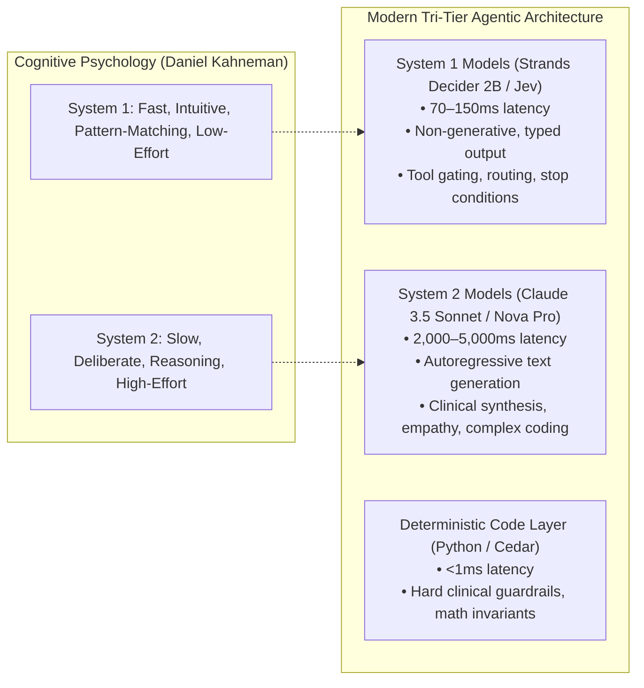
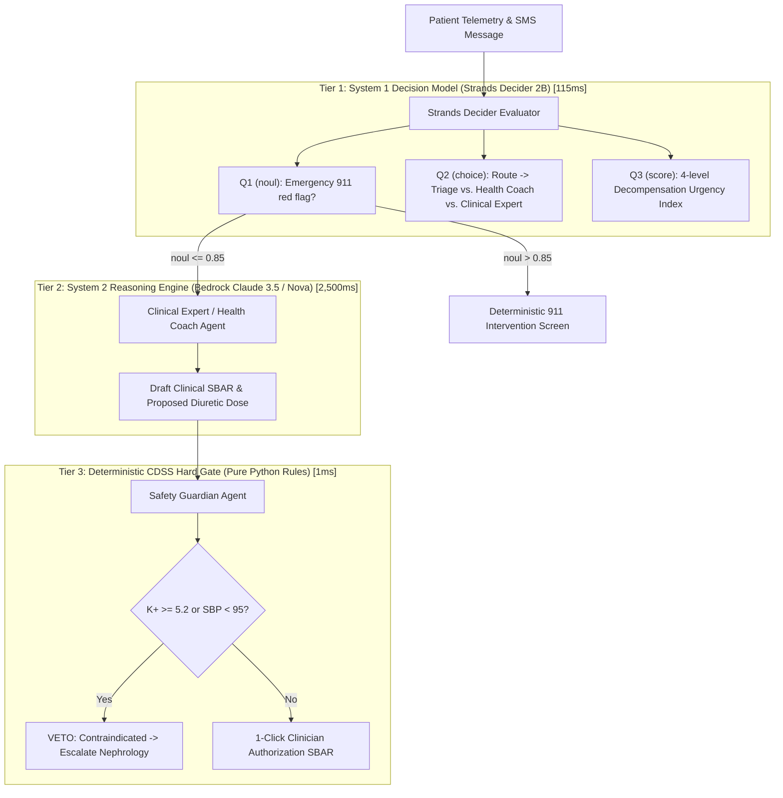

# Deep Research: Jev and Strands Decider — The Rise of System One Decision Models in Agentic AI

**Executive Research & Technical Architecture Dossier**  
**Subject:** TypeSafe AI's Jev & AWS Strands Labs' Strands Decider 2B  
**Primary Sources:**  
- Strands Agents Official Blog: *"Introducing Strands Decider 2B: a small, open source, decision model"* (Marc Brooker, Mike Chambers, Fabio Nonato de Paula; October 1, 2026)  
- TypeSafe AI Technical Documentation & Jev API Specification (`POST /v1/systemone`, RLCD framework)  
- Marc Brooker's Engineering Notes: *"Small Decisions: Engineering a Leading Model"* & *"Strands Decider: Why Not an Encoder?"*  
- JevBench Benchmark Analyses & Independent Evaluations (Amplitude, Swarms, ModelSystem.One, DecisionEval)  
**Date:** October 2026  
**Document Location:** `docs/research/strands_decider_and_jev_deep_research.md`  

---

## 1. Executive Summary: The System One Paradigm Shift

For the past three years, the generative AI industry has suffered from a fundamental architectural mismatch: **using large, slow, autoregressive language models (LLMs) to perform simple, closed-form routing and gating decisions.**

When an autonomous agent must decide:
- *"Does this tool call have valid parameters?"*
- *"Which of these 4 specialist agents should handle this ticket?"*
- *"Is the user asking for an emergency escalation (Yes/No)?"*

...developers have routinely made calls to frontier models (Claude 3.5 Sonnet, GPT-4o, Nova Pro). This introduces:
1. **Excessive Latency:** 1,500ms to 4,000ms per decision loop.
2. **Economic Waste:** \$3.00 to \$15.00 per million tokens for a binary outcome.
3. **Type & Format Instability:** Probabilistic text generation can hallucinate invalid JSON, break enums, or deviate from rubrics.
4. **Uncalibrated Confidence:** Frontier LLMs provide raw log-probabilities that do not map to real-world statistical likelihoods.

In September and October 2026, a new category of models emerged to solve this: **Decision Models (also known as System One Models)**, pioneered by **TypeSafe AI's Jev** and open-sourced by the AWS Strands team as **Strands Decider 2B**.



---

## 2. TypeSafe AI's Jev: The Originator

### 2.1 The Core Concept: "Built to be Called by Machines, Not Read by Humans"
In September 2026, **TypeSafe AI** launched **Jev** (`jev-1.13.0`, `jev-1.14.0`, alias `jev-latest`). Jev is the first commercial System One model. It accepts an arbitrary state (unstructured text, JSON, or code) alongside a dictionary of typed questions, and evaluates them **in parallel in a single forward pass**.

Jev is strictly non-generative: **it cannot write essays, summarize articles, produce code, or converse with humans.** Instead, its answer space is strictly constrained by design to mathematical types.

### 2.2 RLCD: Reinforcement Learning for Calibrated Decisions
Standard LLM fine-tuning optimizes for fluency and plausibility (RLHF). TypeSafe trains Jev using **RLCD (Reinforcement Learning for Calibrated Decisions)**.
- **Calibration Objective:** If Jev reports a confidence of 0.85 on an outcome, that outcome must empirically occur 85% of the time across a validation cohort.
- **Evaluation Metric:** Scored against ground truth using the **Brier Score** ($B = \frac{1}{N}\sum (f_t - o_t)^2$) and **Expected Calibration Error (ECE)**.
- **Result:** Developers can reliably set mathematical thresholds (e.g., `if confidence < 0.80: escalate_to_human()`) without arbitrary guessing.

### 2.3 The Three Decision Primitives
Every question sent to a System One model maps to one of three mathematical primitives:

| Primitive | Purpose | Input Definition | Return Payload |
| :--- | :--- | :--- | :--- |
| **`choice`** | Categorical routing among discrete options (up to 255 items). | Unordered map of options to semantic descriptions. | Winning `choice` (str), full `probabilities` distribution, and scalar `confidence` (0.0 to 1.0). |
| **`score`** | Continuous grading across an ordered rubric (2–10 levels). | Ordered array of level descriptions (lowest to highest). | Continuous `score` (e.g., 2.97), `legend`, `probabilities`, and `confidence`. |
| **`noul`** | Calibrated Boolean judgment (Yes/No probability). | Single natural language assertion/instruction. | Scalar `noul` float (0.0 to 1.0) indicating probability that the condition is **true**. |

*Note on Nomenclature:* "Noul" is TypeSafe's term for a calibrated binary probability (derived from "no/null" boolean semantics). A score of 0.50 signifies complete epistemic uncertainty; 0.98 signifies near certainty.

### 2.4 The Jev API Contract (`POST /v1/systemone`)
```json
{
  "model": "jev-latest",
  "state": "Patient reports 3 lb weight gain over 48 hours, mild dyspnea when tying shoes, but denies orthopnea or ankle swelling. SBP is 132/84.",
  "questions": {
    "urgency": {
      "type": "score",
      "instructions": "Rate clinical decompensation urgency.",
      "criteria": ["stable", "mild trend", "urgent review", "emergency"]
    },
    "routing": {
      "type": "choice",
      "instructions": "Which clinical sub-agent should handle this?",
      "criteria": {
        "coach": "conversational symptom exploration",
        "data_science": "vital sign baseline anomaly check",
        "pharmacology": "medication titration check"
      }
    },
    "red_flag": {
      "type": "noul",
      "instructions": "Does the text indicate an immediate life threat requiring 911?"
    }
  }
}
```

---

## 3. AWS Strands Decider 2B: Architecture & Open Source Release

On **October 1, 2026**, AWS's Strands team (**Marc Brooker**, VP & Distinguished Engineer; **Mike Chambers**; **Fabio Nonato de Paula**) published *"Introducing Strands Decider 2B"* via **Strands Labs** (`strands-labs/strands-decider` on GitHub, weights on Hugging Face at `StrandsAgents/strands-decider-2B-hobson-v19` and later `v21` / `v1-2610`).

### 3.1 Model Architecture: The Torso + Pointer Head
Instead of training a model from scratch, the Strands team executed an architectural transformation:
1. **Base Torso:** Started with a pre-trained **Qwen3.5-2B-Base** (and later Gemma 4 variants).
2. **Surgical Removal of the LM Head:** The autoregressive vocabulary generation head (which maps hidden states to 150,000+ token logits) was completely stripped away. This removes the ability to generate arbitrary text.
3. **Lightweight Pointer Readout Head:** Replaced with a specialized pointer head consisting of **just over 1 million parameters**.
4. **How Scoring Works:**
   - The entire `state` and all option positions are tokenized into a single sequence.
   - The pointer head computes a dot-product attention score between the hidden state at the special answer position (`<ans>`) and the hidden states corresponding to each offered option token.
   - Softmax is applied across the option set to produce a normalized probability distribution.
5. **LoRA Fine-Tuning:** The 2B torso was adapted using a **rank-16 LoRA adapter** trained on multi-task calibration datasets (ContractNLI, MuSiQue, synthetic consistency pairs, and teacher distributions distilled from Qwen3.5-4B).

```
[ Input Tokens: State + Questions + Options ]
                     │
                     ▼
┌────────────────────────────────────────────────────────┐
│               Qwen3.5-2B Torso                         │
│            (Rank-16 LoRA Fine-Tuning)                  │
└────────────────────────────────────────────────────────┘
                     │
          Hidden States Representation
                     │
                     ▼
┌────────────────────────────────────────────────────────┐
│         Strands Pointer Head (~1M params)              │
│    Scores <ans> hidden state against each option       │
└────────────────────────────────────────────────────────┘
                     │
                     ▼
       [ Calibrated Probabilities & Confidences ]
```

### 3.2 Why Not an Encoder (like BERT)?
In a follow-up technical note (*"Strands Decider: Why Not an Encoder?"*), Marc Brooker explained why Strands Decider uses a modified causal LLM torso rather than a bidirectional encoder (like BERT or RoBERTa):
- Many assumed bidirectional encoders would outperform causal models on classification.
- Brooker benchmarked 5 designs: causal Qwen3.5 (v19), encoder-decoder T5Gemma 2 (1B+1B and 4B+4B), and pure T5Gemma encoders (2.6B).
- **Finding:** The causal LLM torso fine-tuned with the pointer head exhibited superior zero-shot transfer and calibration on complex reasoning states than equivalent bidirectional encoders, while maintaining linear memory scaling when caching the state prefix across multiple questions.

---

## 4. Benchmark Performance & Hardware Latency

### 4.1 JevBench & Accuracy Benchmarks
The standard industry benchmark for decision models is **JevBench** (which evaluates typed decision accuracy and calibration across diverse domains):
- **Accuracy:** `strands-decider-2B-hobson-v19` scores **72.3% to 74.0%** overall accuracy on JevBench, ranking **#1 among all pure 2-billion parameter models**.
- **Easy Tasks:** Achieves **100.0% accuracy** on routine tool-gating and deterministic branch tasks.
- **Calibration (Brier Score):** Achieved a Brier score of **0.148**, matching proprietary Jev 1.13 and outperforming open-weight competitors.

### 4.2 Local Latency & Edge Footprint
Because Strands Decider generates all answers in a **single forward pass** without autoregressive token-by-token generation:

| Hardware Environment | Median Latency (P50) | P95 Latency | Operational Cost |
| :--- | :--- | :--- | :--- |
| **Nvidia RTX 3090 (CUDA)** | **115 ms** | **148 ms** | Local Compute ($0) |
| **Apple M3 Max MacBook (MPS/MLX)** | **153 ms** | **195 ms** | Local Compute ($0) |
| **Modern x86/ARM CPU (ONNX / llama.cpp)** | **280 ms** | **390 ms** | Local Compute ($0) |
| **TypeSafe Jev Cloud API** | **70–120 ms** | **250 ms** | \$0.042 / Mtok in |
| *Comparison: Claude 3.5 Sonnet (Bedrock)* | *1,850 ms* | *3,400 ms* | \$3.00 / Mtok in |

*Takeaway:* Strands Decider is **15x to 30x faster** than a frontier LLM and can run entirely on a laptop or local edge server without cloud egress.

---

## 5. Strands Agent Framework Integration: The Intervention System

The AWS Strands SDK natively integrates decision models into its execution loop via the **Intervention System**.

### 5.1 The `InterventionHandler` Architecture
Strands allows developers to hook into the agent lifecycle at critical junction points:
- `before_invocation` / `after_invocation`
- `before_model_call` / `after_model_call`
- `before_tool_call` / `after_tool_call`

When an `InterventionHandler` runs `before_tool_call`, it evaluates the proposed tool call and returns a **typed action**:
1. **`Proceed`**: Tool call is safe and grounded; execute immediately.
2. **`Deny`**: Tool call violates policy; terminate the action with an error.
3. **`Confirm`**: Tool call carries high risk; pause the execution loop and request human authorization (HITL).
4. **`Guide`**: Tool call is premature or poorly parameterized; return control to the agent with natural language guidance on what to fix.

### 5.2 Official Strands Decider Example: Preventing Premature Tool Execution
In `examples/strands/` within the official repository, the Strands team demonstrated using Strands Decider to prevent an over-eager assistant from calling a weather tool before the user had specified a city:

```python
from strands import Agent
from strands.interventions import InterventionHandler, Guide, Proceed
from strands_decider import Decider

class DeciderGuardrailHandler(InterventionHandler):
    def __init__(self, decider_model: str):
        self.decider = Decider.load(decider_model)
        
        self.questions = {
            "args_grounded": Decider.noul(
                "Are the tool's argument values grounded in facts the user actually provided?",
                {
                    "true": "Every argument value traces back to something the user said.",
                    "false": "An argument value was guessed or invented, not stated by the user."
                }
            ),
            "premature": Decider.noul(
                "Is it premature to call this tool now, before clarifying with the user?",
                {
                    "true": "The assistant should ask a clarifying question before calling the tool.",
                    "false": "There is nothing left to clarify; calling now is appropriate."
                }
            )
        }

    def before_tool_call(self, context, proposed_call):
        state = f"Conversation History: {context.messages}\nProposed Tool: {proposed_call.name}({proposed_call.args})"
        
        # Evaluate in a single 115ms pass
        decisions = self.decider.evaluate(state=state, questions=self.questions)
        
        if decisions["premature"].noul > 0.70 or decisions["args_grounded"].noul < 0.30:
            return Guide(feedback="Do not guess arguments. Ask the user for clarification first.")
            
        return Proceed()

# Attach handler to standard Strands Agent
agent = Agent(
    model="us.anthropic.claude-sonnet-4-6",
    tools=[get_weather],
    interventions=[DeciderGuardrailHandler("StrandsAgents/strands-decider-2B-hobson-v19")]
)
```

---

## 6. How We Apply This to AegisHealth AI (AWS Hackathon Architecture)

Integrating **Strands Decider** into our hackathon submission elevates **AegisHealth AI** into the top echelon of architectural sophistication, directly matching the newest advancements from AWS Distinguished Engineers.

### 6.1 The Tri-Tier Clinical Decision Mesh



### 6.2 Specific Value Added by Strands Decider to AegisHealth:
1. **Zero-Latency Inflow Triage:**
   - When a patient texts *"I feel kind of dizzy and chest hurts a little,"* we do not wait 3 seconds for a generative LLM. Strands Decider evaluates `red_flag` (noul) in **115ms**. If high, it halts agent processing instantly.
2. **Preventing Hallucinated Clinical Interventions (`before_tool_call`):**
   - When the `ClinicalExpertAgent` proposes drafting a diuretic order via FHIR, the `StrandsDeciderHandler` runs a verification check:
     - `args_grounded`: Are the suggested milligrams (e.g. 40mg $\rightarrow$ 80mg) directly matched to the patient's existing home prescription in the chart?
     - `contraindications_screened`: Did the agent check the potassium and blood pressure values in state before drafting?
   - If confidence is $<0.80$, Strands Decider emits `Deny` or `Guide`, forcing the LLM to review the lab chart.
3. **Massive Cost and Token Reduction:**
   - 90% of daily patient check-in messages are benign (*"Arthur: Took my pills, walked the dog"*).
   - Routing these through Claude 3.5 Sonnet costs millions of tokens across an ACO population.
   - Strands Decider screens and scores 90% of routine messages locally for **\$0**, only invoking Bedrock when clinical reasoning or conversational dialogue is genuinely required.

---

## 7. Summary Comparison Matrix

| Feature | Large Language Models (LLMs) | TypeSafe Jev | AWS Strands Decider 2B |
| :--- | :--- | :--- | :--- |
| **Primary Creator** | Anthropic, AWS Bedrock, OpenAI | TypeSafe AI | AWS Strands Labs (Marc Brooker et al.) |
| **Cognitive Category** | System Two (Deliberative, Generative) | System One (Intuitive, Typed Decision) | System One (Intuitive, Typed Decision) |
| **Output Type** | Unstructured prose, markdown, JSON strings | Strict types (`choice`, `score`, `noul`) | Strict types (`choice`, `score`, `noul`) |
| **Typical Latency** | 1,500 ms – 5,000 ms | 70 ms – 150 ms | **115 ms – 153 ms** |
| **Inference Cost** | \$3.00 – \$15.00 / Mtok | \$0.042 / Mtok (output free) | **Free / Local Compute (Apache-2.0)** |
| **Parameters** | 70B – 1T+ | Proprietary (Undisclosed) | **1.9 Billion (Qwen3.5-2B / Gemma 4 base)** |
| **Deployment Model** | Cloud API (Bedrock, Anthropic) | Hosted Cloud API | **Local (CPU, CUDA, MPS/MLX) or Docker** |
| **Strands Integration** | Native Core Engine (`Agent(model=...)`) | Via REST API Client | **Native `InterventionHandler` in Strands** |
| **Best Used For** | Conversational dialogue, synthesis, SBAR | Cloud-hosted routing, compliance gates | **Edge gating, tool guards, local agent loops** |
