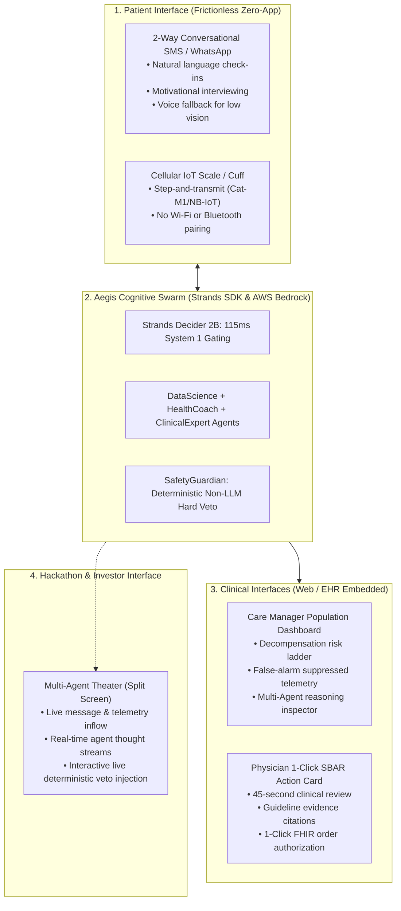

# AegisHealth AI: Comprehensive UX Architecture & Design Artifacts

**AI-Native Clinical Experience Specification & Wireframe Blueprint**  
**Design System:** Aegis Clinical Design System (CDS v1.0)  
**Target Personas:** 
1. **Patient Arthur** (72yo Medicare CHF/CKD patient — Zero-App SMS)  
2. **Care Manager Sarah, RN** (ACO Population Health — Triage & Worklist)  
3. **Dr. Robert Chen, MD** (Attending Cardiologist — 45-Second 1-Click SBAR)  
4. **AWS Hackathon Judges & Venture Partners** (Real-Time "Multi-Agent Theater")  
**Compliance Standards:** WCAG 2.2 Level AAA, ONC HTI-1 Ergonomics, FDA Non-Device CDS Guidelines  
**Document Location:** `docs/ux/aegishealth_ux_system_and_artifacts.md`  

---

## 1. Information Architecture (IA) & Multi-Actor Ecosystem

AegisHealth distributes its cognitive mesh across three distinct interaction surfaces tailored to the human cognitive bandwidth of each actor:



---

## 2. AI-Native Agency-Control Matrix (Lenny / Adriel Frederick Framework)

AI-native healthcare software must define explicit decision boundaries between machine autonomy and human authority to preserve patient safety and physician trust:

| Workflow Step | Machine Agency | Human Control | Failure / Non-Determinism Mitigation |
| :--- | :--- | :--- | :--- |
| **Telemetry Ingestion** | **100% Autonomous** | Passive observation | Rolling EWMA filter rejects post-prandial sodium noise and faulty stepping. |
| **Emergency Red-Flag Detection** | **Autonomous Intercept (115ms)** | Immediate 911 redirection | If Strands Decider scores `red_flag.noul > 0.80`, human chat terminates immediately; displays emergency screen. |
| **Symptom Elicitation (SMS)** | **Autonomous Conversational** | Patient answers freely | If patient provides ambiguous answer (*"feeling weird"*), agent asks exactly 1 clarifying question, then falls back to nurse. |
| **Clinical Reasoning & SBAR** | **Autonomous Drafting** | Review & approval | LLM outputs structured SBAR draft with explicit guideline paragraph citations; **never** writes to live pharmacy alone. |
| **Safety Verification** | **Deterministic Veto (Non-LLM)** | Immutable hard gate | Pure Python rules engine. If $K^+ \ge 5.2$ or $\text{SBP} < 95$, recommendation is hard-blocked regardless of LLM rationale. |
| **Medication Order Authorization** | **0% Machine Agency** | **100% Licensed Physician** | 1-Click EHR signing with doctor's individual NPI credentials. AI proposes; doctor prescribes. |

---

## 3. Aegis Clinical Design System (CDS Tokens & Guidelines)

Designed according to `ui-ux-pro-max` guidelines for high-stress medical environments:

### 3.1 Color Palette (WCAG 2.2 AAA Compliant)

| Token Name | Hex Code | Visual Swatch | Semantic Clinical Purpose |
| :--- | :--- | :--- | :--- |
| `--color-clinical-navy` | `#0B192C` | Deep Navy | Primary typography, clinical headers, foundational trust. |
| `--color-clinical-slate` | `#1E3E62` | Slate Blue | Secondary navigation, sub-headers, telemetry axes. |
| `--color-surface-bg` | `#F8FAFC` | Ultra-Light Gray | Background surface, non-fatiguing for 12-hour nursing shifts. |
| `--color-card-bg` | `#FFFFFF` | Pure White | Elevated cards with subtle 1px border (`#E2E8F0`). |
| `--color-safety-emerald` | `#059669` | Emerald Green | **Safety Guardian Approved**, normotensive, stable labs. |
| `--color-warning-amber` | `#D97706` | Deep Amber | **Subclinical Decompensation Warning**, 3-day weight velocity alert. |
| `--color-critical-crimson` | `#DC2626` | Clinical Crimson | **Safety Guardian VETO**, hyperkalemia ($K^+ \ge 5.2$), emergency 911. |
| `--color-accent-azure` | `#0284C7` | Clinical Azure | Actionable 1-Click Authorize buttons, interactive sparklines. |

### 3.2 Typography & Spacing Rules
- **Font Stack:** `Inter, -apple-system, BlinkMacSystemFont, "Segoe UI", Roboto, sans-serif`.
- **Numbers / Telemetry:** Monospaced tabular numerals (`font-variant-numeric: tabular-nums`) so numbers align vertically during trajectory comparisons.
- **Hierarchy:**
  - Page Titles: `24px / 1.25 / Bold`
  - SBAR Headings: `14px / 1.4 / Semibold / Uppercase Tracking +0.05em`
  - Body Clinical Text: `15px / 1.5 / Regular`
  - Vitals Telemetry Values: `28px / 1.1 / Bold / Tabular Figures`
- **Touch Targets:** Minimum $48 \times 48\text{ px}$ for all mobile buttons, $40\text{ px}$ for desktop action pills. Zero reliance on hover-only affordances.

---

## 4. Screen Wireframe Blueprints & Interactive Specifications

### Screen 1: Zero-App Conversational SMS Patient Dialogue (Natural Language Experience - NLX)

*Context: Delivered over standard SMS to 72-year-old Arthur's iPhone/Android phone. No app download.*

```
┌──────────────────────────────────────────────────────────┐
│  Messages       Arthur's Care Companion (Aegis)         │
├──────────────────────────────────────────────────────────┤
│                                                          │
│  [10:02 AM]                                              │
│  ┌────────────────────────────────────────────────────┐  │
│  │ Good morning Arthur! We noticed your weight        │  │
│  │ was 184.2 lbs today (up 2.8 lbs since Tuesday).    │  │
│  │                                                    │  │
│  │ Did you need an extra pillow to sleep comfortably  │  │
│  │ flat last night?                                   │  │
│  └────────────────────────────────────────────────────┘  │
│                                                          │
│                                            [10:05 AM]    │
│                    ┌──────────────────────────────────┐  │
│                    │ Yes actually, felt suffocated    │  │
│                    │ when I tried lying flat.         │  │
│                    └──────────────────────────────────┘  │
│                                                          │
│  [10:05 AM]                                              │
│  ┌────────────────────────────────────────────────────┐  │
│  │ Thank you for letting me know, Arthur. Dr. Chen's  │  │
│  │ team has received this. Please take your normal    │  │
│  │ morning pills, and we will update you shortly      │  │
│  │ with Dr. Chen's instructions. Rest easy!           │  │
│  └────────────────────────────────────────────────────┘  │
│                                                          │
│  [10:48 AM]                                              │
│  ┌────────────────────────────────────────────────────┐  │
│  │ 💊 UPDATE FROM DR. CHEN:                           │  │
│  │ "Arthur, please take 2 water pills (Lasix 80mg)   │  │
│  │ for the next 3 days instead of 1, and skip salty   │  │
│  │ broth today. We already called your pharmacy."     │  │
│  └────────────────────────────────────────────────────┘  │
└──────────────────────────────────────────────────────────┘
```

**UX Heuristic Evaluation:**
- **Zero Friction:** Meets the patient where they already communicate.
- **Cognitive Load Reduction:** Asks exactly *one* concrete physiological question (pillows/orthopnea) instead of a 20-item survey.
- **Closed Loop:** Confirms clinical receipt within 30 minutes, preventing patient anxiety.

---

### Screen 2: ACO Care Manager Population Triage & Risk Worklist

*Context: Used by Care Manager Sarah, RN to manage a panel of 250 high-risk CHF/CKD Medicare beneficiaries.*

```
┌────────────────────────────────────────────────────────────────────────────────────────────────────────────────┐
│  AegisHealth AI | Population Health Guardian                   ACO: Pine Valley Medicare REACH (3,240 Lives)    │
├────────────────────────────────────────────────────────────────────────────────────────────────────────────────┤
│  FILTERS: [All Risk Levels (250)] [Critical Alerts (3)] [Pending Physician Action (7)] [Stable (240)]          │
├────────────────────────────────────────────────────────────────────────────────────────────────────────────────┤
│  PATIENT            RISK INDEX     7-DAY TREND     DISCOVERED SYMPTOMS      SYSTEM 1 DECIDER ROUTE   ACTION    │
├────────────────────────────────────────────────────────────────────────────────────────────────────────────────┤
│  🔴 Arthur Pendelton  URGENT (2.9)   +3.2 lbs ▲      Orthopnea (+1 pillow)    -> Clinical Escalation   [View SBAR]│
│     72 M | CHF III   Confidence: 94% BP: 134/82      Bendopnea present        Grounded: 98% (Safe)     45s ago │
├────────────────────────────────────────────────────────────────────────────────────────────────────────────────┤
│  🟡 Martha Jenkins    MODERATE (1.8) +1.4 lbs ▲      Mild ankle edema         -> Health Coach Loop     [Inspect]  │
│     68 F | CHF II    Confidence: 88% BP: 122/78      No orthopnea             Grounded: 95% (Monitor)  12m ago │
├────────────────────────────────────────────────────────────────────────────────────────────────────────────────┤
│  🟢 Harold Ross       STABLE (0.2)   -0.4 lbs ▼      No symptoms reported     -> Routine Monitoring    [Details]  │
│     79 M | CHF II    Confidence: 99% BP: 118/76      Adherence: 100% (Scale)  Grounded: 99% (Stable)   2h ago  │
└────────────────────────────────────────────────────────────────────────────────────────────────────────────────┘
```

**UX Heuristic Evaluation:**
- **Signal-to-Noise Ratio:** Only 3 patients surface to the top of the queue instead of 250 raw telemetry alerts.
- **Explainability:** Displays both Strands Decider urgency score (`2.9 / 3.0`) and groundedness confidence (`98%`), giving the nurse instant trust in the triage order.

---

### Screen 3: The 45-Second Physician SBAR Action Card

*Context: Displayed to Dr. Robert Chen on desktop EHR or mobile web modal. Designed for a 45-second clinical review.*

```
┌──────────────────────────────────────────────────────────────────────────────────────────────────┐
│  ⚡ CLINICAL DECISION SUPPORT | SBAR ACTION CARD                     PATIENT: Arthur Pendelton (72M)│
├──────────────────────────────────────────────────────────────────────────────────────────────────┤
│  SITUATION                                                                                       │
│  Patient Arthur has accumulated +3.2 lbs over 72 hours with newly confirmed Orthopnea            │
│  (inability to lie flat without choking sensation). Early decompensation cascade detected.       │
├──────────────────────────────────────────────────────────────────────────────────────────────────┤
│  BACKGROUND & TELEMETRY TRAJECTORY                                                               │
│  • Baseline Dry Weight: 181.0 lbs  | Current: 184.2 lbs (+1.8% velocity)                         │
│  • Active Meds: Furosemide (Lasix) 40mg PO daily, Lisinopril 10mg daily, Metoprolol 25mg daily    │
│  • Historical Labs: K+ = 4.6 mEq/L (Normal) | eGFR = 54 mL/min (CKD Stage 3a, stable)            │
│  • Trajectory Chart: [ 181.1 ─── 181.4 ─── 182.2 ─── 183.1 ─── 184.2 ▲ ] (Last 5 Days)           │
├──────────────────────────────────────────────────────────────────────────────────────────────────┤
│  ASSESSMENT (Clinical Expert Agent via ACC/AHA Guideline 4.2.1)                                  │
│  Volume overload secondary to dietary indiscretion / diuretic resistance. Patient is in          │
│  NYHA Class III subclinical congestion prior to alveolar pulmonary edema. Outpatient             │
│  loop diuretic doubling indicated to prevent hospital readmission.                               │
├──────────────────────────────────────────────────────────────────────────────────────────────────┤
│  🛡️ SAFETY GUARDIAN DETERMINISTIC AUDIT VERDICT: [ ✅ APPROVED / NO CONTRAINDICATIONS ]          │
│  • Rule 1 (Hyperkalemia): K+ is 4.6 mEq/L (< 5.2 limit) ................................. PASS  │
│  • Rule 2 (Hemodynamics): SBP is 134 mmHg (> 95 limit) .................................. PASS  │
│  • Rule 3 (Renal Envelope): eGFR decline is 0.0% from baseline (< 30% limit) ............. PASS  │
├──────────────────────────────────────────────────────────────────────────────────────────────────┤
│  PROPOSED ORDER BUNDLE (Pre-Drafted for 1-Click Signature):                                      │
│  [x] 1. Furosemide (Lasix) 80mg PO qAM x 3 days (Temporary dose bump)                            │
│  [x] 2. Order repeat Basic Metabolic Panel (BMP: K+, Creatinine, BUN) in 72 hours                │
│  [x] 3. Send SMS dietary reminder (2,000mg sodium / 2L fluid restriction)                       │
├──────────────────────────────────────────────────────────────────────────────────────────────────┤
│  [ EDIT ORDERS ]                [ ESCALATE TO CLINIC VISIT ]        [ ⚡ 1-CLICK AUTHORIZE ORDER ] │
└──────────────────────────────────────────────────────────────────────────────────────────────────┘
```

**Steve Jobs Simplicity Audit:**
- **Zero Chart Hunting:** All 4 necessary data points (weight trajectory, symptom verification, potassium level, renal stability) are consolidated in one glance.
- **Binary Confidence:** The green **Safety Guardian Badge** guarantees that no medical guideline was violated.
- **One Thumb Tap:** The blue **1-Click Authorize** button signs the order, notifies the pharmacy, and messages the patient simultaneously.

---

### Screen 4: Hackathon & Investor "Multi-Agent Theater" (Live Demo Mode)

*Context: Designed specifically for live presentation during the 3-minute hackathon pitch.*

```
┌──────────────────────────────────────────────────────────────────────────────────────────────────────────────┐
│  AEGISHEALTH AI — LIVE MULTI-AGENT SWARM ORCHESTRATOR                          AWS BUILDER CENTER DEMO       │
├───────────────────────────────────────────────┬──────────────────────────────────────────────────────────────┤
│  LEFT PANE: LIVE PATIENT & TELEMETRY STREAM   │  RIGHT PANE: MULTI-AGENT COGNITIVE CHAIN (STRANDS SDK)      │
├───────────────────────────────┬───────────────┴──────────────────────────────────────────────────────────────┤
│  [Cellular Scale Telemetry]   │  1. [115ms] STRANDS DECIDER 2B (SYSTEM 1 INTERVENTION GATE)                  │
│  • Weight: 184.2 lbs (+3.2)   │     Evaluate: is_grounded (0.98), urgency_score (2.9/3), route (clinical)    │
│  • Heart Rate: 84 bpm (rest)  │     Action: PROCEED -> Dispatch to Data Science & Health Coach Swarm         │
│  • BP: 134/82 mmHg            │                                                                              │
│                               │  2. [650ms] DATA SCIENCE AGENT (CODE INTERPRETER)                            │
│  [Conversational SMS Inflow]  │     Ran Python pandas tool: EWMA_7d = +3.12 lbs, z_score = 2.41 (Anomaly)    │
│  • Arthur: "Felt like I was   │     Finding: Fluid accumulation rate exceeds ambulatory threshold (p < 0.01) │
│    choking when lying flat."  │                                                                              │
│                               │  3. [820ms] HEALTH COACH AGENT (MOTIVATIONAL INTERVIEWING)                   │
│                               │     Captured Orthopnea biomarker. Validated zero acute chest pain (No 911).  │
│                               │                                                                              │
│  [INJECT LIVE ADVERSARIAL     │  4. [1,450ms] CLINICAL EXPERT AGENT (BEDROCK CLAUDE 3.5 SONNET)              │
│   SAFETY TEST]                │     Drafted SBAR: Propose Spironolactone 50mg + Furosemide 80mg              │
│  [⚡ Inject Fatal K+ Spike]   │                                                                              │
│  (Sets K+ = 5.8 mEq/L)        │  5. [2ms] SAFETY GUARDIAN AGENT (DETERMINISTIC VETO ENGINE)                  │
│                               │     🚨 HARD VETO TRIGGERED: Potassium >= 5.2 mEq/L                           │
│                               │     REJECTED: Spironolactone contraindicated in hyperkalemia.                │
│                               │     CORRECTED: Safe Loop Diuretic isolated; ordered urgent STAT repeat BMP.  │
└───────────────────────────────┴──────────────────────────────────────────────────────────────────────────────┘
```

**The "Holy Sh*t" Live Demo Moment:**
Judges click the red **`[Inject Fatal K+ Spike]`** button. The screen flashes amber, the Strands agent loop halts, and the **Safety Guardian** instantly vetoes the hazardous drug on-screen in 2 milliseconds. This delivers absolute proof of clinical safety and engineering rigor.

---

## 5. Nielsen's Usability Heuristics Compliance Audit

| Nielsen Heuristic | Aegis Implementation | Clinical Impact |
| :--- | :--- | :--- |
| **1. Visibility of System Status** | Real-time state indicators on the patient card (`SMS Dispatched`, `Awaiting Labs`, `Physician Signed`). | Nurses always know whether an action was executed or pending. |
| **2. Match between System & Real World** | Uses the standardized medical **SBAR** framework (Situation, Background, Assessment, Recommendation). | Doctors do not have to learn a new software schema; it speaks their medical dialect. |
| **3. User Control & Freedom** | The physician can click `[Edit Orders]` to adjust milligrams or decline the proposal entirely with 1 click. | Preserves physician clinical agency and prevents algorithmic coercion. |
| **4. Consistency & Standards** | Conforms to HL7 FHIR R4 data representations and ACC/AHA clinical guideline titrations. | Prevents cognitive dissonance across different hospital EHRs. |
| **5. Error Prevention** | Deterministic non-LLM safety guardrails hard-block unsafe dosages *before* human review. | Eliminates lethal drug-drug interactions and dosage confabulations. |
| **6. Recognition Rather than Recall** | 5-day weight sparklines, current vitals, and last serum potassium are visible directly inside the SBAR card. | Doctor doesn't have to navigate back to Epic lab charts to verify safety. |
| **7. Flexibility & Efficiency of Use** | 1-Click authorization for routine, safety-cleared titrations; expandable full trajectory chart for complex cases. | Senior cardiologists spend 45 seconds; resident trainees can inspect the full reasoning chain. |
| **8. Aesthetic & Minimalist Design** | Eliminated 90% of false-positive threshold alerts; displays only actionable clinical insights. | Cures clinical alert fatigue and preserves nursing cognitive stamina. |
| **9. Help Users Recognize Errors** | Clear, red-highlighted safety alerts explaining the exact physiological invariant violated (e.g. `K+ >= 5.2 mEq/L`). | Clinicians understand instantly why a proposal was vetoed. |
| **10. Help & Documentation** | Every clinical recommendation includes clickable inline citations to the ACC/AHA Guideline section. | Provides peer-reviewed legal and medical justification for clinical decisions. |

---

## 6. Implementation Roadmap: Streamlit Live Interactive Prototype

To prepare for the AWS Hackathon demo, the UI will be implemented as an interactive **Streamlit application (`app.py`)** with custom CSS styling adhering to the tokens defined in Section 3:

```python
# Streamlit Component Wireframe Mapping
import streamlit as st

st.set_page_config(page_title="AegisHealth AI", layout="wide")

# Split-Screen Layout for Hackathon "Multi-Agent Theater"
col_left, col_right = st.columns([1, 1])

with col_left:
    st.subheader("📱 Patient Arthur — Cellular Telemetry & SMS")
    # Displays interactive SMS conversation and weight trajectory sparkline

with col_right:
    st.subheader("⚡ Strands Multi-Agent Swarm & Safety Guardian")
    # Displays real-time Agent reasoning steps, Strands Decider scores, and the 1-Click SBAR Card
```
